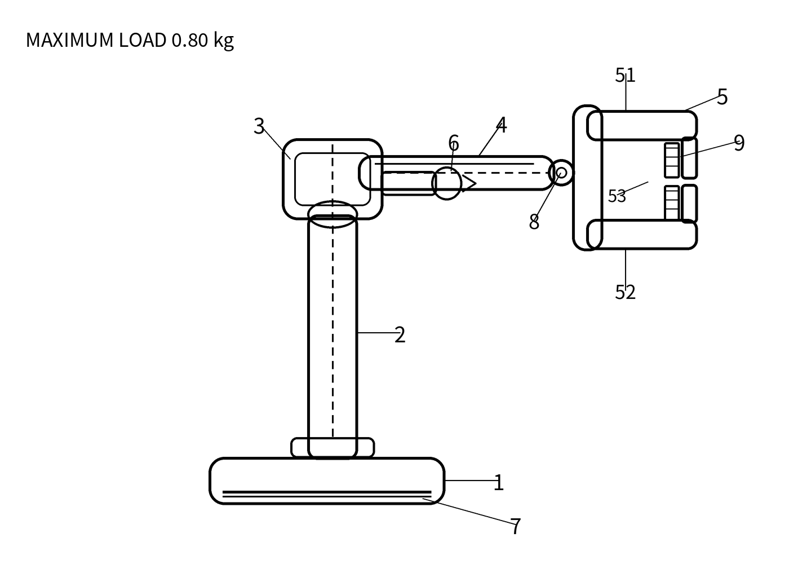

# Adjustable Clamping Support

## Claims

1. An adjustable clamping support, comprising a base (1), an upright post (2), a sliding sleeve (3), an arm (4), and a holder (5); a lower end of the upright post (2) is connected to the base (1); the sliding sleeve (3) is disposed around the upright post (2) and is provided with a locking member (6); a first end of the arm (4) is connected to the sliding sleeve (3), and a second end of the arm (4) is connected to the holder (5); the holder (5) comprises a first jaw (51) and a second jaw (52) disposed opposite each other, and a clamping opening (53) is formed between the first jaw (51) and the second jaw (52).
2. The adjustable clamping support according to claim 1, wherein the second end of the arm (4) is connected to the holder (5) by a pivot (8), and the holder (5) is rotatable about the pivot (8).

## Description

### Technical Field

The present application relates to the technical field of desktop supporting devices, and in particular to an adjustable clamping support.

### Background

When a small instrument, sign, or sheet-like article is temporarily placed on a desktop, a support is often needed to raise and clamp the article. Existing supports generally have a fixed distance between a holder and a base, so a support must be replaced when articles have different heights. The clamping orientation can also be difficult to adjust, and a clamped article may drift away from a viewing direction.

### Summary of the Invention

The present application addresses the technical problem of providing an adjustable clamping support that allows the height and angle of the holder to be adjusted and reduces slippage on a surface of a clamped article.

To solve the technical problem, the adjustable clamping support comprises a base, an upright post, a sliding sleeve, an arm, and a holder. A lower end of the upright post is connected to the base. The sliding sleeve is disposed around the upright post and is provided with a locking member. A first end of the arm is connected to the sliding sleeve, and a second end of the arm is connected to the holder. The holder comprises a first jaw and a second jaw disposed opposite each other, and a clamping opening is formed between the first jaw and the second jaw.

The base has a lower surface provided with an anti-slip pad extending continuously along an outer edge of the base. The second end of the arm is connected to the holder by a pivot, so that the holder is rotatable about the pivot. Removable elastomer pads are respectively provided on inner sides of the first jaw and the second jaw.

The adjustable clamping support has the following beneficial effects. The sliding sleeve can move along the upright post and be positioned by the locking member, so the height of the holder can be changed. The holder can rotate about the pivot to adjust the orientation of an article. The anti-slip pad improves stability of the base on a desktop, and the elastomer pads provide flexible contact inside the clamping opening.

### Brief Description of the Drawings

FIG. 1 is an exploded structural schematic view of an adjustable clamping support according to an embodiment of the present application.

### Detailed Description

Referring to FIG. 1, the adjustable clamping support of this embodiment comprises a base 1, an upright post 2, a sliding sleeve 3, an arm 4, and a holder 5. The base 1 is a rounded rectangular plate. A lower surface of the base 1 is provided with a continuous annular anti-slip pad 7. The upright post 2 extends upward from a raised portion at the center of the base 1.

The sliding sleeve 3 is disposed around the upright post 2. A side wall of the sliding sleeve 3 is provided with a locking member 6. The locking member 6 is a screw passing through the side wall of the sliding sleeve 3 and abutting the upright post 2 when tightened, so that the sliding sleeve 3 is held at a selected height. A first end of the arm 4 is connected to the sliding sleeve 3, and the arm 4 extends horizontally.

The second end of the arm 4 is connected to the holder 5 by a pivot 8. The holder 5 comprises a first jaw 51, a second jaw 52, and a clamping opening 53 between the two jaws. Removable elastomer pads 9 are respectively provided on inner sides of the first jaw 51 and the second jaw 52. The elastomer pads 9 protrude toward the clamping opening 53 and are disposed opposite each other on two sides of the clamping opening 53.

In use, the locking member 6 is loosened, the sliding sleeve 3 is moved along the upright post 2 to a selected height, and the locking member 6 is tightened. The holder 5 is rotated about the pivot 8 to adjust its orientation. An article to be clamped is placed in the clamping opening 53 so that two sides of the article contact the two elastomer pads 9. The base 1 contacts the desktop through the anti-slip pad 7.

Table 1: Representative dimensions and rating

| Component | Dimension or rating | Unit |
| --- | --- | --- |
| Base 1 footprint | 120 × 80 | mm |
| Upright post 2 height | 180 | mm |
| Clamping opening 53 width | 8–32 | mm |
| Maximum load | 0.80 | kg |

## Abstract

An adjustable clamping support includes a base, an upright post, a sliding sleeve, an arm, and a holder. The sliding sleeve is disposed around the upright post and has a locking member. The arm connects the sliding sleeve to the holder. A clamping opening is formed between a first jaw and a second jaw of the holder. The support is used for supporting and clamping small desktop articles.

## Drawings

