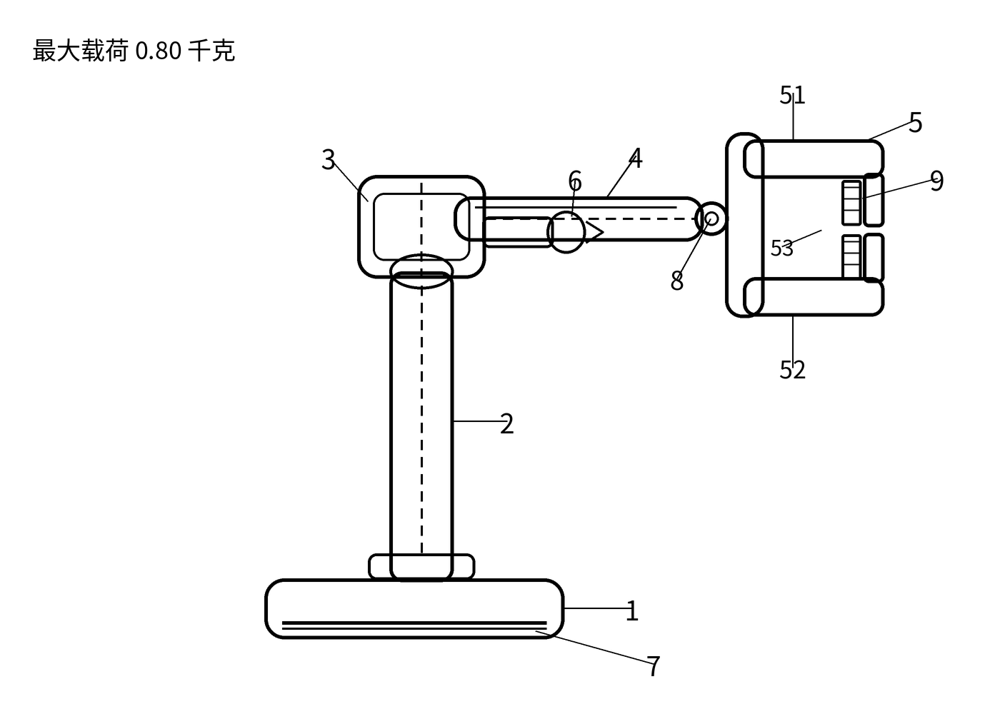

# 一种可调节夹持支架

## 权利要求书

1. 一种可调节夹持支架，其特征在于，包括底座（1）、立柱（2）、滑套（3）、横臂（4）和夹持件（5）；所述立柱（2）的下端与所述底座（1）连接；所述滑套（3）套设在所述立柱（2）上，并设有锁紧件（6）；所述横臂（4）的第一端与所述滑套（3）连接，所述横臂（4）的第二端与所述夹持件（5）连接；所述夹持件（5）包括相对设置的第一夹爪（51）和第二夹爪（52），所述第一夹爪（51）与所述第二夹爪（52）之间形成夹持口（53）。
2. 根据权利要求1所述的可调节夹持支架，其特征在于，所述横臂（4）的第二端通过转轴（8）与所述夹持件（5）连接，所述夹持件（5）能够绕所述转轴（8）转动。

## 说明书

### 技术领域

本申请涉及桌面支撑装置技术领域，具体涉及一种可调节夹持支架。

### 背景技术

在桌面上临时放置小型仪器、标牌或薄片物件时，常需要借助支架抬高并夹持物件。现有支架的夹持件与底座之间的距离通常固定，物件高度不同时需要更换支架；夹持角度也难以调整，物件放入后可能偏离观察方向。

### 发明内容

本申请要解决的技术问题是提供一种可调节夹持支架，使夹持件的高度和角度能够调整，并减少夹持时物件表面的滑移。

为解决上述技术问题，所述可调节夹持支架包括底座、立柱、滑套、横臂和夹持件。所述立柱的下端与所述底座连接。所述滑套套设在所述立柱上，并设有锁紧件。所述横臂的第一端与所述滑套连接，所述横臂的第二端与所述夹持件连接。所述夹持件包括相对设置的第一夹爪和第二夹爪，所述第一夹爪与所述第二夹爪之间形成夹持口。

所述底座的下表面设有沿所述底座外缘连续延伸的防滑垫。所述横臂的第二端通过转轴与所述夹持件连接，使所述夹持件能够绕所述转轴转动。所述第一夹爪和所述第二夹爪的内侧分别设有可拆卸的弹性体垫。

所述可调节夹持支架具有以下有益效果：所述滑套能够沿所述立柱移动并由所述锁紧件定位，从而改变所述夹持件的高度；所述夹持件能够绕所述转轴转动，以调整物件的朝向；所述防滑垫提高所述底座在桌面上的稳定性，所述弹性体垫在所述夹持口内形成柔性接触。

### 附图说明

图1为本申请实施例提供的可调节夹持支架的爆炸结构示意图。

### 具体实施方式

参见图1，本实施例的可调节夹持支架包括底座1、立柱2、滑套3、横臂4和夹持件5。底座1为圆角矩形板。底座1的下表面设有连续的环形防滑垫7。立柱2从底座1中央的凸台向上延伸。

滑套3套设在立柱2上。滑套3的侧壁设有锁紧件6。锁紧件6为穿过滑套3侧壁的螺杆，旋紧后抵靠立柱2，使滑套3保持在选定高度。横臂4的第一端与滑套3连接，横臂4沿水平方向延伸。

横臂4的第二端通过转轴8与夹持件5连接。夹持件5包括第一夹爪51、第二夹爪52以及两个夹爪之间的夹持口53。第一夹爪51和第二夹爪52的内侧分别设有可拆卸的弹性体垫9。弹性体垫9朝向夹持口53凸出，并在夹持口53的两侧相对布置。

使用时，旋松锁紧件6，使滑套3沿立柱2移动至选定高度，再旋紧锁紧件6。转动夹持件5绕转轴8调整朝向，将待夹持物件放入夹持口53，使物件两侧分别接触两个弹性体垫9。底座1通过防滑垫7与桌面接触。

表1：代表性尺寸与额定值

| 部件 | 尺寸或额定值 | 单位 |
| --- | --- | --- |
| 底座1底面 | 120 × 80 | mm |
| 立柱2高度 | 180 | mm |
| 夹持口53宽度 | 8–32 | mm |
| 最大载荷 | 0.80 | kg |

## 说明书摘要

本申请公开一种可调节夹持支架。该支架包括底座、立柱、滑套、横臂和夹持件。滑套套设在立柱上并设有锁紧件，横臂连接滑套与夹持件，夹持件的第一夹爪与第二夹爪之间形成夹持口。该支架用于支撑和夹持桌面小型物件。

## 说明书附图

