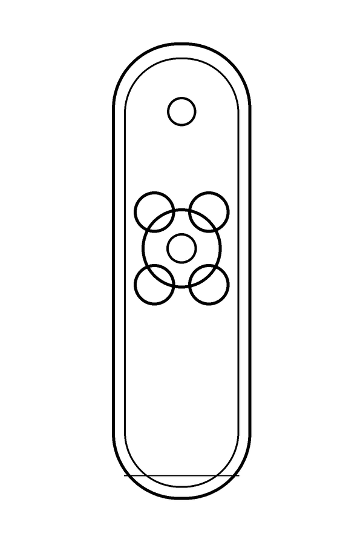
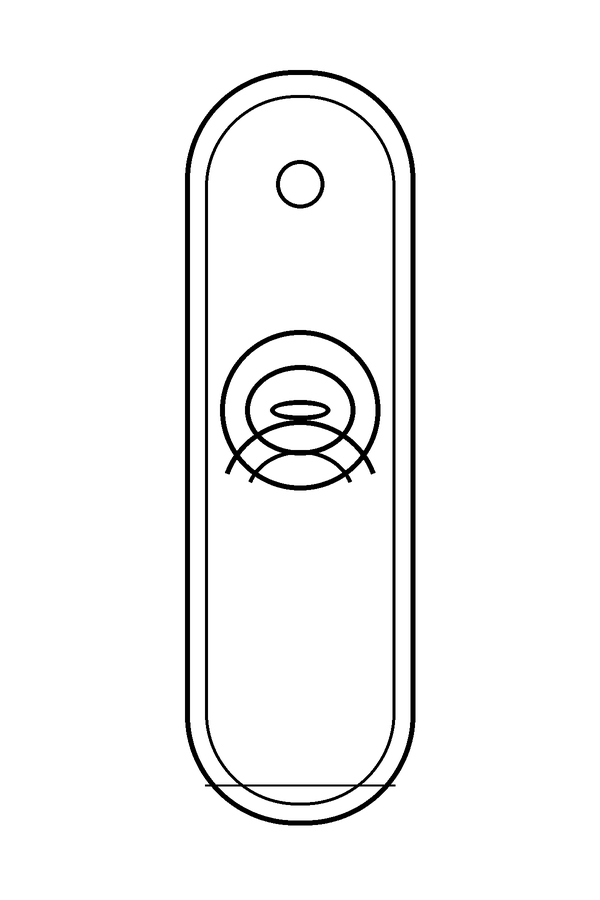

# 书签

## 外观设计图片或照片

## 外观设计简要说明

产品用途：用于标记书页位置。

设计要点：在于拱形顶部的薄片轮廓、靠近顶部的悬挂孔，以及正面的圆形或弧形装饰纹样。

最能表明设计要点的图片或照片：设计1主视图

基本设计：设计1

设计1和设计2为同一产品的相似设计，二者具有相同的整体轮廓和悬挂孔，区别在于正面装饰纹样。

视图省略：各设计的后视图、左视图、右视图、俯视图、仰视图省略，原因：产品为薄片状平面书签，背面无装饰，厚度和侧面不构成设计要点。
